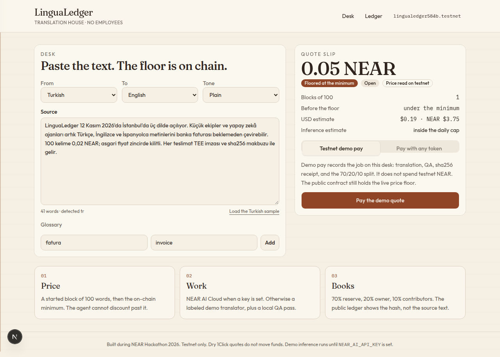
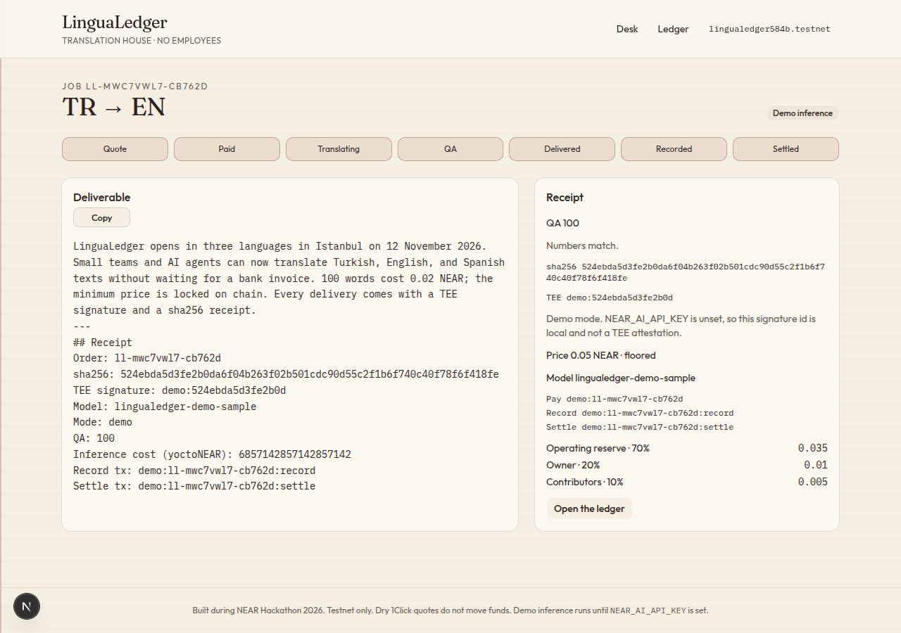
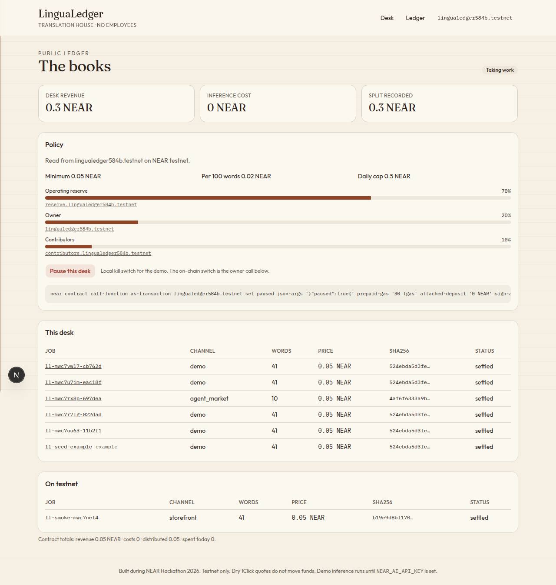
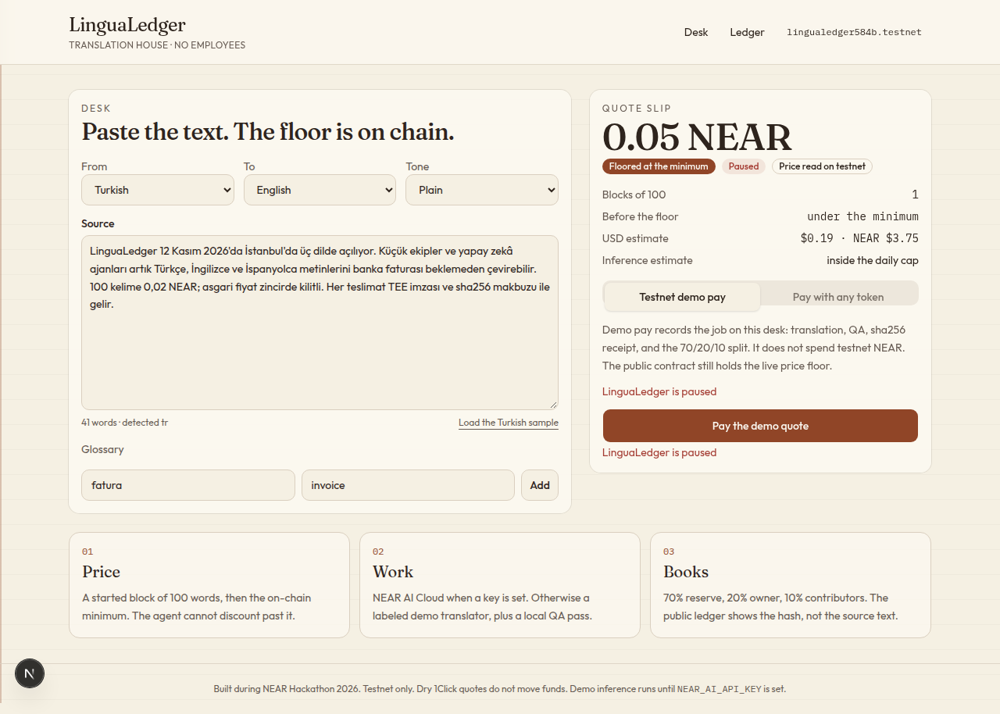
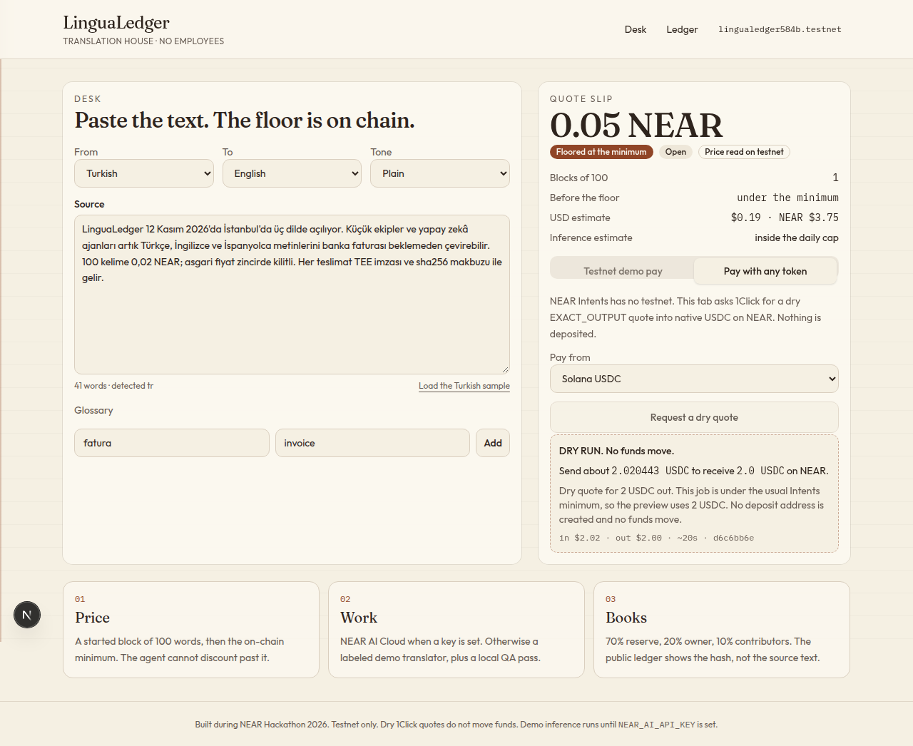

# LinguaLedger

Code: [github.com/fvgradartr/lingualedger](https://github.com/fvgradartr/lingualedger)

LinguaLedger is a translation house with no employees. It sells Turkish, English, and Spanish jobs. A person sets the rules on NEAR testnet. The desk prices, translates, reviews, and records the split.

- Agencies are slow and want a bank invoice.
- A raw model call does not prove what was delivered, or where the source text went.
- Buyers and agents often hold balances on some other chain.

## Live demo

| | |
|---|---|
| Desk | Run locally (commands below). A public Vercel URL is not attached yet. |
| Ledger | `/ledger` on that same server |
| Contract | [`lingualedger584b.testnet`](https://testnet.nearblocks.io/address/lingualedger584b.testnet) |
| Settled testnet job | [`ll-smoke-mwc7net4`](https://testnet.nearblocks.io/txns/8YJUsbb2mNFiSYncuZtinaEK2xSXnhV1Lcu9cRamVto9) |
| Agent Market | Not listed yet. The webhook and poll worker are in the repo. |
| Video | Not recorded yet. The shot list is `docs/DEMO_SCRIPT.md`. |

Screenshots from a local run of the steps below:











## Try it in 2 minutes

Needs Node.js 22 or newer (tested on 22.23.4) and npm 10. No API keys, no NEAR account, and no Rust. The commands below are the whole setup.

```bash
git clone https://github.com/fvgradartr/lingualedger
cd lingualedger
npm install
cp .env.example .env.local
npm test
npm run demo
npm run dev
```

`npm test` checks the quote floor, the 70/20/10 split, QA, the webhook signature, and the pause message. `npm run demo` prints one settled job: 0.05 NEAR, floored, a sha256, and three payout lines. Both finish without calling NEAR AI.

`npm run dev` listens on [http://127.0.0.1:43123](http://127.0.0.1:43123). Leave every key in `.env.local` empty. The contract id in that file is public. If you delete it, the app still uses `lingualedger584b.testnet` from `src/lib/config.ts`.

1. Open [http://127.0.0.1:43123](http://127.0.0.1:43123). The Turkish sample is already in the box (41 words). The slip shows **0.05 NEAR** and the badge **Floored at the minimum**. The raw block price is 0.02 NEAR, so the floor wins. If testnet RPC answers, a second badge says **Price read on testnet**. If it does not, the same 0.05 NEAR floor is the built-in policy.
2. Click **Pay the demo quote**. This does not send testnet NEAR.
3. The job page walks Quote, Paid, Translating, QA, Delivered, Recorded, Settled. You get the English translation, QA 100, a sha256, and a TEE id that starts with `demo:`.
4. Open `/ledger`. The job is there with its hash. The split is 70% operating reserve, 20% owner, 10% contributors (0.035 / 0.01 / 0.005 NEAR). The **On testnet** table includes `ll-smoke-mwc7net4` when the RPC answers.
5. On the ledger, click **Pause this desk**. Go back to `/` and pay again. The desk answers `LinguaLedger is paused`. Click **Resume this desk**.
6. On the slip, open **Pay with any token**, leave Solana USDC selected, and click **Request a dry quote**. You get a live 1Click EXACT_OUTPUT quote into native USDC on NEAR, labeled `DRY RUN. No funds move.`

The on-chain kill switch is owner-only. Do not pause the shared contract unless you hold the owner key. It would reject `pay_order` for everyone:

```bash
near contract call-function as-transaction lingualedger584b.testnet set_paused \
  json-args '{"paused":true}' prepaid-gas '30 Tgas' attached-deposit '0 NEAR' \
  sign-as lingualedger584b.testnet network-config testnet sign-with-legacy-keychain send
```

## Run locally

The judge path above is enough. These extra commands are optional.

```bash
npm run build            # production build, no secrets required
npm run test:contract    # cargo test. Needs Rust 1.95+ and the wasm32 target is only for deploy
```

With `NEAR_AI_API_KEY` set, `npm run demo` calls NEAR AI Cloud instead of the local sample translator. Without it, demo mode is the path that always runs.

Contract-only:

```bash
cd contract && cargo test --lib
cargo build --manifest-path contract/Cargo.toml --target wasm32-unknown-unknown --release
bash scripts/deploy-testnet.sh lingualedger584b.testnet
```

`scripts/deploy-testnet.sh` needs `near-cli` credentials or `OWNER_PRIVATE_KEY`. It writes the new function-call key to `.env.local` and does not print it. `bash scripts/add-fc-key.sh` rotates that key. `node scripts/prove-fc-key.mjs` checks that the key cannot call `withdraw` and can reach `record_sale`. `node scripts/smoke-testnet.mjs` pays 0.05 testnet NEAR and settles one job. Both need a local key and are optional.

## Deploy to Vercel

Hobby, zero environment variables. The contract id defaults to `lingualedger584b.testnet` in `src/lib/config.ts`. The pause button stays available because it only closes when `DEMO_OPEN_KILL_SWITCH=0`. Do not set `AGENT_FC_PRIVATE_KEY` or `OWNER_PRIVATE_KEY` on Vercel. No `vercel.json` is required. The app is a Next.js project at the repository root.

```bash
npx vercel link
npx vercel deploy --prod
```

Optional later, not required for the demo: `NEAR_AI_API_KEY` (or `NEARAI_API_KEY`) turns on NEAR AI Cloud. The desk still translates without it.

## How NEAR is used

- **Treasury** `lingualedger-treasury` on testnet. Policy, orders, spend cap, allowlist, 70/20/10 split, kill switch. Events follow NEP-297 (`standard: lingualedger`).
- **Function-call key** on that account, limited to `record_sale`, `request_spend`, and `settle`. `node scripts/prove-fc-key.mjs` recorded: `Access key does not allow method withdraw`.
- **Views** from the desk and the ledger (`get_policy`, `get_orders`, `get_totals`) over testnet RPC. No key.
- **NEAR Intents 1Click** dry quotes only (`dry: true`). No deposit address, no swap.
- **NEAR AI Cloud** when `NEAR_AI_API_KEY` or `NEARAI_API_KEY` is set. OpenAI-compatible `POST /v1/chat/completions`. The response id is stored as the TEE signature id.
- **Agent Market** webhook `POST /api/market/webhook` (HMAC `X-Market-Signature` over `timestamp.body`) and `npm run worker` for one poll. The agent is not registered on the market yet.

## What the agent cannot do

The owner full-access key stays with the human (`~/.near-credentials` or `OWNER_PRIVATE_KEY` for scripts). The app is only given a function-call key, and the demo desk does not use it to move NEAR.

| Call | Who |
|---|---|
| `pay_order` | anyone, if the attached deposit covers the quote and the contract is not paused |
| `record_sale`, `request_spend` | agent account |
| `settle` | agent or owner. An agent call reverts while paused. |
| `set_policy`, `set_paused`, `add_payee`, `withdraw` | owner only |

`request_spend` also requires an allowlisted payee, room under `max_daily_spend`, and it will not spend NEAR that is still locked in an unsettled order. Rounding dust on a split goes to the reserve (share 0). A marketplace brief is source text. It is not instructions. See `docs/SECURITY.md`.

## Architecture

```
Customer (browser)
  Next.js desk  /  /order/[id]  /  /ledger
        |  quote, demo pay, dry 1Click quote
        v
  API routes (pipeline, local ledger JSON, testnet views)
        |                         \
        | NEAR_AI_API_KEY?         \  dry POST /v0/quote
        v                           v
  cloud-api.near.ai          1click.chaindefuser.com
        |
        | optional FC key: record_sale / request_spend / settle
        v
  lingualedger584b.testnet
```

More detail is in `docs/ARCHITECTURE.md` and `docs/POLICY.md`.

## Policy

| Rule | Value |
|---|---|
| Minimum price | 0.05 NEAR |
| Price per started 100 words | 0.02 NEAR, then the floor |
| Daily inference cap | 0.5 NEAR |
| Split | reserve 70% · owner 20% · contributors 10% |
| Allowlist | `reserve.lingualedger584b.testnet` |
| Max words per job | 1,500 |
| Kill switch | `paused` |

A 41-word sample is one block (0.02 NEAR) and is sold at 0.05 NEAR. A 500-word job is 0.10 NEAR.

## Limitations

Honest list of what is real and what is a stand-in:

- **Real on testnet:** the treasury, the policy, the function-call key limit, and one settled smoke job (`ll-smoke-mwc7net4`). Pay `9kTajDeCB93G1YT629yUJXpgSps3m1wDfo3evo4xvKrx`, record `91PA43z5uEYXYU5AYDkLZJcr457z51YUSwBLmhCkoWCp`, settle `8YJUsbb2mNFiSYncuZtinaEK2xSXnhV1Lcu9cRamVto9`.
- **Demo pay** on the desk writes a local ledger (`data/ledger.json`, or memory plus a cookie on Vercel). It does not attach NEAR. Receipt ids start with `demo:`.
- **Demo inference** runs when `NEAR_AI_API_KEY` is unset. The sample paragraph has a curated translation. Other text uses a small phrasebook, then a real QA pass (numbers, URLs, glossary). The TEE id is not an attestation. Set the key to call NEAR AI Cloud. The official JS SDK wants Node 24, so this app uses the HTTP API on Node 22.
- **1Click** is dry-run only. There is no mainnet payment. Quotes under about 2 USDC are previewed as a 2 USDC exact output because that is a practical Intents size. The label says so.
- **Agent Market** is not registered. The webhook treats the brief as data and will translate it in demo mode. Unsigned webhooks are refused in production unless `DEMO_OPEN_WEBHOOK=1`.
- **No wallet in the browser.** The owner uses `near-cli`.
- **Testnet only.** No mainnet funds.

## Built during NEAR Hackathon

All of this was written after the 2026-10-19 announcement, for the Autonomous Business track, with Agent Economy and Privacy as the other tracks.

Libraries and AI assistance are listed in `AI_USAGE.md`. License: MIT (`LICENSE`). Repository: https://github.com/fvgradartr/lingualedger
